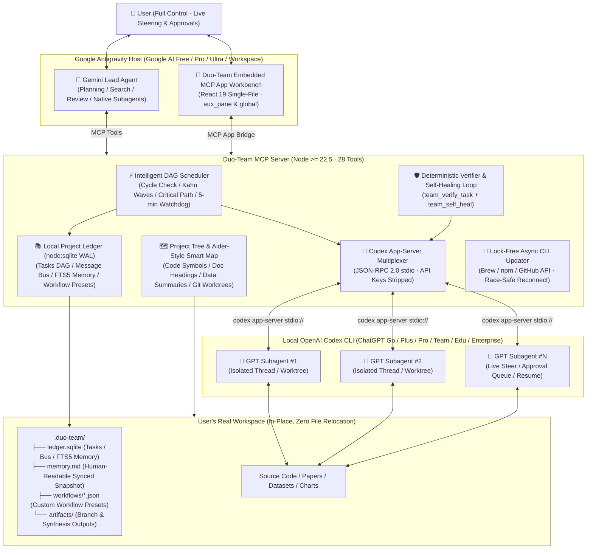

<p align="center">
  
</p>

<h1 align="center">Duo-Team</h1>

<p align="center">
  <strong>Subscription-Native Gemini (Antigravity) + GPT (OpenAI Codex CLI) Multi-Agent Collaboration Workbench</strong><br/>
  $0 Extra API Cost · Official Protocol Bridge · 6 Collaboration Modes · Intelligent DAG Scheduler & Self-Healing · SQLite FTS5 Tiered Memory · Embedded MCP App UI
</p>

<p align="center">
  <strong>English</strong> · <a href="./README.zh-CN.md">简体中文</a>
</p>

<p align="center">
  
  
  
  
  
  
</p>

---

## Table of Contents

1. [Why Duo-Team? Design Philosophy & Subscription Compliance](#1-why-duo-team-design-philosophy--subscription-compliance)
2. [Technical Architecture & Engineering Roadmap](#2-technical-architecture--engineering-roadmap)
3. [The 6 Collaboration Modes — Deep Comparison & Playbook](#3-the-6-collaboration-modes--deep-comparison--playbook)
4. [Quick Start & Installation](#4-quick-start--installation)
5. [Workbench UI Guide (5 Interactive Tabs)](#5-workbench-ui-guide-5-interactive-tabs)
6. [Real-World Playbooks (Research / Engineering / Multi-Subagent Squads)](#6-real-world-playbooks-research--engineering--multi-subagent-squads)
7. [Custom Workflow JSON Schema (`.duo-team/workflows/*.json`)](#7-custom-workflow-json-schema-duo-teamworkflowsjson)
8. [Complete Reference of All 28 MCP Tools](#8-complete-reference-of-all-28-mcp-tools)
9. [Project Layout, Testing & Privacy Guarantees](#9-project-layout-testing--privacy-guarantees)
10. [FAQ & Roadmap](#10-faq--roadmap)

---

## 1. Why Duo-Team? Design Philosophy & Subscription Compliance

If you use any combination of **Google AI (Free / Pro / Ultra / Workspace)** and **ChatGPT (Go / Plus / Pro / Team / Edu / Enterprise)** subscriptions, getting Gemini and GPT to truly collaborate on code, research, or writing normally hits three walls:

1. **Double-paying via API tokens**: Traditional multi-agent frameworks (CrewAI, AutoGen, LangGraph) require pay-as-you-go API keys. Long-context research papers or repository-wide refactors quickly burn tens of dollars while your existing subscriptions sit idle.
2. **Account ban risks from unofficial proxies**: Scraping browser cookies, proxying OAuth tokens, or wrapping Antigravity inside headless daemon loops is fragile and violates terms of service.
3. **Single-model role-playing**: Asking one model family to be both author and reviewer creates correlated blind spots — it rarely catches deep architectural flaws, subtle econometrics identification mistakes, or edge-case regressions.

### The Solution: Asymmetric Compliance

Duo-Team strictly honors the official boundaries of both platforms:

- **Antigravity (Google AI Free / Pro / Ultra / Workspace) remains the human-initiated interactive host**: You always initiate sessions inside Antigravity, unlocking Gemini's native file/terminal/web tools, `invoke_subagent`, `run_workflow`, and embedded MCP App panels. Duo-Team **never** automates Antigravity from external background loops or touches Google credentials.
- **Codex CLI (ChatGPT Go / Plus / Pro / Team / Edu / Enterprise) runs as an official local protocol worker pool**: Duo-Team connects to OpenAI's official `codex app-server --listen stdio://` JSON-RPC 2.0 daemon, explicitly **strips `OPENAI_API_KEY` and `CODEX_API_KEY`**, and auto-detects your real account tier plus dual rate-limit windows (e.g., Plus's 5-hour rolling window + 7-day cap) — guaranteeing **$0 extra API billing**.

### Multi-Tier Subscription Adaptation Matrix (Google × ChatGPT)

Duo-Team auto-detects your real Codex plan tier (`plus`, `pro`, `team`, `edu`, `enterprise`, `go`, `free`) and pairs it with your chosen Google tier (`Free`, `AI Pro`, `AI Ultra`, `Workspace`) to tune concurrency, clamp adaptive reasoning efforts to what your models actually support, and protect tighter quota windows with one click:

| Subscription Pairing | Rec. Codex Concurrency | Adaptive Effort Ceiling | Low-Quota Alert | Optimal Delegation Strategy |
| :--- | :---: | :---: | :---: | :--- |
| **Google AI Ultra × ChatGPT Pro / Enterprise** | `4 ~ 6` | `max` | `15%` | **Full-Throttle Dual Flagship**: High concurrency on both sides for Autonomous Team, Blind Research, and multi-round Debate |
| **Google AI Ultra × ChatGPT Plus** | `2` | `high` | `25%` | **Gemini-Heavy + Precision GPT**: Offload 70% exploration/synthesis/parallel checks to Gemini Ultra; reserve Codex Plus for core coding & critical review |
| **Google AI Pro × ChatGPT Pro** | `4` | `max` | `15%` | **GPT Heavy-Lift + Gemini Lead**: Delegate heavy coding, econometrics, and self-healing loops to Codex Pro while Gemini leads planning & verification |
| **Google AI Pro × ChatGPT Plus** | `2` | `high` | `25%` | **Quota-Smart Balanced**: Enable adaptive routing so light tasks drop to `low/medium` while critical path tasks use `high` |
| **Google AI Pro × ChatGPT Team / Edu** | `3` | `xhigh` | `20%` | **Balanced Team / Lab**: 50/50 comparative-advantage split for Co-Creation and Custom Workflow presets |
| **Google AI Free × ChatGPT Pro** | `4` | `max` | `15%` | **Codex Primary Engine**: Keep Antigravity focused on lightweight coordination and approvals while Codex Pro handles bulk execution |

| Dimension | Duo-Team (Subscription-Native) | API-Key Multi-Agent Frameworks | Unofficial Wrappers / Proxies |
| :--- | :--- | :--- | :--- |
| **Extra API Cost** | **$0** (reuses your Google AI & ChatGPT subscriptions) | Metered per-token API spend | Fragile & high ban risk |
| **Protocol Compliance** | 100% official (Antigravity Plugin + `codex app-server`) | Official APIs | Violates ToS / breaks frequently |
| **Cross-Model Diversity** | Genuine dual-family (Gemini + GPT-6.x / Codex) | Genuine, high setup overhead | Often serial copy-paste |
| **Human-in-the-Loop Control** | Embedded MCP App UI + live `Steer` + inline approvals | CLI logs only | No unified control plane |
| **Persistent Context** | SQLite WAL + FTS5 memory + Smart Repo Map + thread `Resume` | Requires external vector DB | Lost between sessions |

---

## 2. Technical Architecture & Engineering Roadmap

### 2.1 System Architecture



### 2.2 Seven Technical Pillars

1. **Official `codex app-server` JSON-RPC 2.0 Multiplexer (`server/src/codex/client.ts`)**
   - Maintains a persistent `codex app-server --listen stdio://` child process multiplexing multiple concurrent GPT threads.
   - Paginates `model/list` to dynamically discover every live model and reasoning effort tier (`low / medium / high / xhigh / max / ultra`) available to your account, plus real-time `account/read` and `account/rateLimits/read` quota telemetry.
   - Supports mid-flight **`turn/steer`** redirection without losing reasoning state, cross-session **`thread/resume`**, parallel batch launching (`codex_spawn_batch`), squad-wide **`codex_broadcast`**, interactive sandbox approvals, and Codex-native child subagent tracking.
   - Features `connGen` race-safe reconnection and a lock-free async CLI updater (`server/src/codex/updater.ts`) that queries `formulae.brew.sh` / npm / GitHub API directly (avoiding Homebrew `lockf` contention) and upgrades in the background with live streaming logs so MCP calls never hit `-32001` timeouts.

2. **Intelligent DAG Scheduler & Self-Healing Verifier (`server/src/scheduler/engine.ts`)**
   - **Topology Diagnostics**: DFS cycle/deadlock detection, Kahn topological wave planning (`Wave 1 → Wave 2 → ...`), critical-path extraction, a 5-minute thread stall watchdog, and tier-aware low-quota concurrency protection.
   - **Role & Subscription-Tier Routing**: Maps tasks across specialized role presets (`planner`, `executor`, `reviewer`) and automatically adapts concurrency and effort ceilings to your Google × ChatGPT subscription tier, always respecting user model locks.
   - **Self-Healing Loop (`team_self_heal`)**: Runs deterministic verification (`verifyCommand` + `artifacts` existence check). On failure, if `reworkCount < maxReworks`, it automatically sends the exact stderr/diff back to the **original `codexThreadId`** for targeted repair; once `maxReworks` is reached, it transitions the task to `awaiting_human` to prevent runaway loops.

3. **SQLite WAL + FTS5 Tiered Shared Memory (`server/src/ledger/store.ts`)**
   - Powered by Node 22.5+'s built-in `node:sqlite` (`DatabaseSync`) — **zero native C++ dependencies**.
   - Stores typed memories (`decision`, `pitfall`, `fact`, `convention`) with pinning and hybrid FTS5 + substring search (seamless for both English and CJK queries).
   - Auto-syncs every structured memory update to human-readable `.duo-team/memory.md`, and `team_auto_dispatch` automatically injects pinned memories, pinned files, and the project map into newly dispatched Codex prompts.

4. **Aider-Style Smart Project Map & Pinned Focus Files (`server/src/ledger/workspace.ts`)**
   - Builds a compact **Smart Project Map** covering code symbols (TS/JS/Python/Go/Rust/R/Stata), document outlines (Markdown/LaTeX headings), and dataset summaries (CSV/TSV/Parquet/DTA/XLSX columns/rows).
   - Lets users pin **Focus Files** directly in the interactive workspace tree, automatically prioritizing them for both Gemini and Codex.
   - Probes live Git status/diff/worktrees and local research/dev toolchains (`python3`, `Rscript`, `stata`, `latex`, `pandoc`, `libreoffice`, `git`, `node`, `uv`).

5. **File Ownership & Automatic Git Worktree Isolation**
   - Enforces a strict multi-reader / single-writer ownership discipline.
   - In Git repositories, parallel code-writing Codex subagents can run with `createWorktree: true`, giving each worker its own isolated Git worktree so concurrent edits never collide.

6. **Native Single-File MCP App Workbench (`ui/src/App.tsx` & `ui/src/styles.css`)**
   - Built with React 19 + TypeScript + Vite (`vite-plugin-singlefile`) into `ui://duo-team/workbench.html` and exposed to both Antigravity's `aux_pane` and `global` surfaces.
   - Features spring-physics animations (`ResizeObserver`-synced nav glider, dual-engine bridge animation, spotlight model cards, circular quota gauge, DAG wave board) and 3-second live auto-sync.

7. **Cross-Platform Zero-Friction Launcher (`bin/duo-team-server`)**
   - Automatically discovers Node `>= 22.5` across `PATH`, `nvm`, `fnm`, `volta`, Homebrew, and standard system directories so Antigravity GUI spawns never suffer from stripped shell `PATH`s.

---

## 3. The 6 Collaboration Modes — Deep Comparison & Playbook

Every mode below is backed by dedicated MCP orchestration primitives and verified end-to-end in `server/src/tests/modes-e2e.test.ts`.

### 3.1 Side-by-Side Comparison Matrix

| Mode ID | Name | Role Division | Parallelism | First-Round Isolation | Core MCP Toolchain | Best-Fit Scenarios | Quota Usage |
| :--- | :--- | :--- | :--- | :--- | :--- | :--- | :--- |
| `plan_execute` | **Plan & Execute** (Free Role Swap) | **Swappable**: Gemini Plans → Codex Executes, or Codex Architects → Gemini/Codex Executes | Wave-parallel by DAG dependencies | Mandatory cross-model Plan Challenge Gate | `team_task_upsert` → `codex_spawn(Plan Reviewer)` → `team_auto_dispatch` → `team_self_heal` | Feature builds, refactors, econometrics replication with strict tests | Medium |
| `co_create` | **Co-Creation** | **Comparative Advantage Split** (Gemini: search/framing/writing; Codex: heavy code/stats/tests) | Mixed Gemini + Codex tasks across milestones | Cross-model milestone review & `challenge` | `team_memory_add` + mixed `owner` tasks + `team_message_post(review/challenge)` | Academic papers, technical specs, full-stack + documentation deliverables | Medium |
| `parallel_research` | **Blind Parallel Research** | Both models independently solve the exact same frozen brief | **True dual-branch concurrency** | **Strict first-round isolation** (neither reads the other's draft) | `codex_spawn(async)` + `invoke_subagent(independent-reviewer)` + `branch_a`/`branch_b` feed | Architecture decisions, literature reviews, tough root-cause debugging | Medium-High |
| `debate` | **Structured Debate** | Pro vs. Con across blind openings + stateful rebuttals + evidence verdict | Concurrent Round 1 + stateful Round 2..N | Blind Round 1 openings, then full cross-examination | `codex_spawn(con)` + `codex_message(same threadId)` + `debate`/`rebuttal`/`verdict` | High-stakes trade-offs, stress-testing hypotheses, mock peer review | Medium |
| `autonomous_team` | **Autonomous Team** | Multi-wave DAG auto-dispatched to parallel GPT + Gemini subagents | **Full wave concurrency** (capped by `maxParallelCodex`) | Per-task deterministic verify + cross-model review | `team_schedule_plan` → `team_auto_dispatch` / `codex_spawn_batch` → `codex_broadcast` → `team_self_heal` | End-to-end projects, long-horizon goals (pairs great with `/goal` or `run_workflow`) | High |
| `custom` | **Custom Workflow** | Defined declaratively in `.duo-team/workflows/*.json` (roles, models, stages, verifiers) | Automatic DAG wave execution from preset `stages` | Configurable per-stage `reviewer` & `verifyCommand` | `team_workflow_preset(list / save / apply)` → `team_schedule_plan` → `team_auto_dispatch` | Lab research pipelines, team TDD sprints, repeatable org SOPs | Preset-driven |

---

### 3.2 How Each Mode Works & Example Prompts

#### 1. Plan & Execute (`plan_execute` — with Role Swapping)
- **Variant A (Gemini Plans → Codex Critiques → Codex Executes → Gemini Reviews)**: Gemini writes the DAG + `verifyCommand`s; spawns a read-only Codex `Plan Reviewer` to challenge assumptions; dispatches ready tasks; runs `team_self_heal` and final review.
- **Variant B (Role Swap: Codex Architects → Gemini Critiques → Mixed Execution → Codex Reviews)**: Ideal for deep systems architecture or complex statistical design — spawn Codex (`role="Lead Architect"`, `effort="xhigh"`) first, challenge weak spots as Gemini, execute, then send deliverables back to the same Codex architect thread for final sign-off.
- **Example Prompt**:
  > "Use Duo-Team **Plan & Execute (Role Swap)**: ask Codex to act as Lead Architect (read-only) and propose a refactoring DAG for our payment module, challenge any weak spots as Gemini, dispatch parallel coding worktrees, and run self-healing verification before final Codex review."

#### 2. Co-Creation (`co_create`)
- Divide work by comparative strength while keeping both models synchronized on `.duo-team/memory.md` and structured FTS5 decisions. Either side can post `kind="challenge"` whenever definitions or assumptions diverge.
- **Example Prompt**:
  > "Run **Co-Creation mode** for this empirical paper: Gemini handles literature synthesis, hypothesis framing, and prose polishing while Codex writes Python/Stata cleaning, DID regressions, and LaTeX tables. Sync key definitions to shared memory and cross-review every milestone."

#### 3. Blind Parallel Research (`parallel_research`)
- Eliminates anchoring bias. Freeze the question and reference paths in `memory.md`, then launch Gemini (`branch-gemini.md`) and Codex (`branch-codex.md`) simultaneously with strict first-round blindness. The Workbench renders `branch_a` vs. `branch_b` side-by-side before generating a unified `synthesis.md` highlighting agreements, contradictions, and verification experiments.
- **Example Prompt**:
  > "Run **Blind Parallel Research** on our production memory leak: do not share your hypothesis with Codex first. Investigate independently in parallel, then synthesize agreements, contradictions, and decisive diagnostics."

#### 4. Structured Debate (`debate`)
- Round 1 collects blind Pro and Con openings simultaneously. Rounds 2..N feed opponent claims back into the **same Codex `threadId`** via `codex_message` so Codex maintains full stateful reasoning context across rebuttals. Concludes with an evidence-ranked `verdict` flagging unresolved trade-offs for the human.
- **Example Prompt**:
  > "Start a **Structured Debate** on 'Migrate our ledger to PostgreSQL vs. keep SQLite WAL': Gemini takes Pro, Codex takes Con, blind Round 1 openings followed by 2 rebuttal rounds and an evidence-backed verdict."

#### 5. Autonomous Team (`autonomous_team`)
- Calls `team_schedule_plan` to compute topological waves and critical path, dispatches all ready wave tasks concurrently via `team_auto_dispatch` / `codex_spawn_batch` (with automatic Git Worktree isolation), verifies every deliverable via `team_self_heal` (auto-reworking failures up to `maxReworks`), preserves `codexThreadId` cleanly if quota runs low, and pauses into `awaiting_human` only when genuine human judgment is needed.
- **Example Prompt**:
  > "Switch to **Autonomous Team mode** to deliver the full export feature (API, UI, tests, docs) in parallel Git worktrees with automated self-healing verification. Pause for my decision only if an architectural trade-off or rework limit is hit."

#### 6. Custom Workflow (`custom`)
- Encapsulate your favorite multi-stage pipeline in `.duo-team/workflows/<presetId>.json`. Use `team_workflow_preset` (`list` / `save` / `apply`) or click a preset chip right inside the Workbench DAG Board to switch mode, apply per-role model routing, and materialize the entire dependency-linked task DAG in one shot.
- **Example Prompt**:
  > "Save a **Custom Workflow** preset named `fullstack-tdd` (Spec → Failing Tests → Parallel Implementation → Cross-Model Security Review) via `team_workflow_preset`, apply it to this project, and dispatch Wave 1."

---

## 4. Quick Start & Installation

### Prerequisites

1. **Antigravity** signed into your **Google AI** account (Free / Pro / Ultra / Workspace).
2. **OpenAI Codex CLI** installed and logged into your **ChatGPT** subscription (Go / Plus / Pro / Team / Edu / Enterprise):
   ```bash
   codex --version
   codex login status
   ```
3. **Node.js `>= 22.5.0`** (uses built-in `node:sqlite`, no external database or native compilation required):
   ```bash
   node -v
   ```

### One-Command Install

```bash
git clone https://github.com/ZhangXY-sdu/duo-team.git
cd duo-team
./install.sh
```

`install.sh` validates Node `>= 22.5`, installs dependencies, builds both the MCP server and the single-file React workbench (`npm run build`), ensures `bin/duo-team-server` is executable, and symlinks the plugin to `~/.gemini/config/plugins/duo-team`. Refresh plugins in **Antigravity → Plugins Manager** and you are ready to go.

---

## 5. Workbench UI Guide (5 Interactive Tabs)

Say **"Open Duo-Team Workbench"** in Antigravity to launch the embedded side pane:

| Tab | What You Can Monitor & Control |
| :--- | :--- |
| **1. Models & Strategy** | Dual-engine live bridge status, circular dual-window quota gauge, Google × ChatGPT subscription tier selector & one-click optimizer, dynamically fetched GPT models & reasoning efforts, role routing, lock-free background Codex CLI updater, and **6-Mode Feature Showcase Cards** |
| **2. Intelligent DAG Board** | Active mode highlight strip, topological wave visualizer (`Wave 1 → Wave 2…`), critical-path badges, cycle/stall warnings, **Visual Custom Workflow Builder** (no manual JSON needed, with 3 starter templates & clickable dependency chips), one-click wave `auto_dispatch`, `self_heal` verification, and inline human decision buttons |
| **3. Codex Squad (Workers)** | Live monitor for all active & historical Codex threads (including Codex-native child agents), **Multi-Subagent Squad Launcher**, mid-flight **Steer** input, squad-wide **Broadcast**, inline sandbox **Approve / Decline**, **Interrupt / Interrupt All**, and one-click historical **Resume** |
| **4. Feed & Debate** | Filterable cross-model message stream (`plan`, `challenge`, `review`, `debate`, `rebuttal`, `verdict`) with side-by-side comparison views for `parallel_research` and `debate` |
| **5. Project Tree & Memory** | Interactive expandable file tree with one-click **Focus File Pinning**, Aider-style **Smart Project Map**, Git status/worktree inspector, local toolchain badges, and full **FTS5 Tiered Memory** search/add/pin/delete synced to `.duo-team/memory.md` |

---

## 6. Real-World Playbooks (Research / Engineering / Multi-Subagent Squads)

Duo-Team bundles 3 specialized skills (`duo-orchestrate`, `duo-research`, `duo-dev`) and an unbiased `independent-reviewer` Gemini subagent:

- **Academic Research & Econometrics (`duo-research`)**: Supports Python, R, Stata, LaTeX, Word, PDF, PPT, and Excel workflows. Pin your data dictionary and outline → run `parallel_research` for identification strategy → build reproducible scripts in `co_create` or a `custom` workflow → run `debate` with Codex acting as a tough Referee #2.
- **Software Engineering (`duo-dev`)**: Architecture critique via `plan_execute` → parallel feature/test coding in isolated Git Worktrees via `autonomous_team` → automated `team_self_heal` test/rework loops → cross-model final code review.
- **Multi-Subagent Squad Control**: Use `codex_spawn_batch` alongside Antigravity's native `invoke_subagent` / `run_workflow` to run heterogeneous Gemini + GPT subagent squads in parallel, steering individual GPT threads mid-flight (`codex_message`) or broadcasting updates to all workers (`codex_broadcast`).

---

## 7. Custom Workflow JSON Schema (`.duo-team/workflows/*.json`)

```json
{
  "id": "fullstack-tdd-sprint",
  "name": "Full-Stack TDD Sprint",
  "description": "Architecture Spec -> Failing Tests -> Parallel Backend & Frontend -> Cross-Model Review",
  "maxReworks": 3,
  "roleModels": {
    "planner": { "model": "GPT-6.2-Sol", "effort": "high" },
    "executor": { "model": "GPT-6.2-Astra", "effort": "high" },
    "reviewer": { "model": "GPT-6.2-Sol", "effort": "xhigh" }
  },
  "stages": [
    {
      "id": "SPEC",
      "title": "API Contract & Schema Design",
      "owner": "gemini",
      "reviewer": "codex",
      "dependsOn": [],
      "acceptanceCriteria": "OpenAPI schema and edge cases frozen in memory.md",
      "verifyCommand": null,
      "artifacts": ["docs/api-contract.md"]
    },
    {
      "id": "BE",
      "title": "Backend Implementation & Unit Tests",
      "owner": "codex",
      "reviewer": "gemini",
      "dependsOn": ["SPEC"],
      "acceptanceCriteria": "All backend unit tests pass cleanly",
      "verifyCommand": "npm run test:backend",
      "artifacts": ["src/server/export.ts", "src/server/export.test.ts"]
    },
    {
      "id": "FE",
      "title": "Frontend UI & Integration Tests",
      "owner": "codex",
      "reviewer": "gemini",
      "dependsOn": ["SPEC"],
      "acceptanceCriteria": "Typecheck and UI tests pass",
      "verifyCommand": "npm run test:ui",
      "artifacts": ["src/ui/ExportPanel.tsx"]
    },
    {
      "id": "REVIEW",
      "title": "Cross-Model Security & Regression Audit",
      "owner": "gemini",
      "reviewer": "codex",
      "dependsOn": ["BE", "FE"],
      "acceptanceCriteria": "Full CI suite passes with zero unresolved P0/P1 findings",
      "verifyCommand": "npm run typecheck && npm test",
      "artifacts": [".duo-team/artifacts/final-review.md"]
    }
  ]
}
```

---

## 8. Complete Reference of All 28 MCP Tools

<details>
<summary>Expand all 28 registered MCP tools</summary>

### A. Codex App-Server Control & Squads (7)
| Tool | Purpose |
| :--- | :--- |
| `codex_status` | Inspect Codex CLI connection, live model/effort catalog, user model locks, quota limits, and active threads |
| `codex_spawn` | Spawn a real Codex thread (`role`, `sandbox`, `model`, `effort`, `async`, `createWorktree`) |
| `codex_spawn_batch` | Concurrently spawn a squad of multiple independent Codex subagents in one call |
| `codex_broadcast` | Broadcast a shared directive to all active (or selected) Codex subagents |
| `codex_wait` | Wait for one or more async Codex threads to finish or reach `waiting_approval` |
| `codex_message` | Send follow-up or mid-flight steering (`turn/steer` when running, `thread/resume` when idle) |
| `codex_control` | `interrupt`, `interrupt_all`, `approve` / `decline` pending approvals, or `reconnect` bridge |

### B. Ledger, Intelligent DAG Scheduling & Workflows (10)
| Tool | Purpose |
| :--- | :--- |
| `team_project_init` | Initialize `.duo-team/` ledger, memory, and workflow folder in-place inside the workspace |
| `team_board_read` | Read full project state (config, tasks, message feed, memory, and Codex runs) |
| `team_task_upsert` | Create or update a DAG task node (`owner`, `reviewer`, `dependsOn`, `verifyCommand`, `artifacts`) |
| `team_message_post` | Post structured cross-model messages (`plan`, `challenge`, `review`, `debate`, `rebuttal`, `verdict`, `note`) |
| `team_verify_task` | Deterministic verification of required `artifacts` and `verifyCommand` exit code |
| `team_schedule_plan` | Diagnose DAG cycles, compute Kahn topological waves, critical path, stall alerts, and adaptive model routing |
| `team_auto_dispatch` | Auto-dispatch all ready wave tasks up to `maxParallelCodex` with pinned memory/files/map injection & Git worktrees |
| `team_self_heal` | Verify task output; auto-rework failures on the same `codexThreadId` or escalate to `awaiting_human` at `maxReworks` |
| `team_workflow_preset` | List, save, or apply `.duo-team/workflows/*.json` custom workflow presets (`list` / `save` / `apply`) |
| `open_workbench` | Open the embedded Duo-Team MCP App Workbench in Antigravity |

### C. Tiered Memory & Project Intelligence (4)
| Tool | Purpose |
| :--- | :--- |
| `team_memory` | Read or directly edit `.duo-team/memory.md` |
| `team_memory_search` | Hybrid SQLite FTS5 + substring search across structured memories (filter by category & pinned state) |
| `team_memory_add` | Add, pin/unpin, or delete typed memories (`decision`, `pitfall`, `fact`, `convention`) with auto-sync to `memory.md` |
| `team_project_map` | Generate Aider-style Smart Project Map, interactive tree, Git diff/worktree status, and local toolchain probe |

### D. Embedded Workbench App-Only Tools (7, `visibility: ["app"]`)
| Tool | Purpose |
| :--- | :--- |
| `ui_dashboard_state` | Fetch unified live snapshot for the workbench UI |
| `ui_update_model_config` | Update global/project model locks, per-role routing, mode, language, and concurrency cap |
| `ui_human_decision` | Submit human approval, rework feedback, or cancellation for `awaiting_human` tasks |
| `ui_check_codex_update` | Lock-free check for newer Codex CLI releases (Homebrew API / npm / GitHub) |
| `ui_upgrade_codex_cli` | Non-blocking background Codex CLI upgrade (`start` / `poll`) with automatic post-upgrade reconnect |
| `ui_toggle_pin_file` | Pin or unpin focus context files from the workspace tree |
| `ui_workspace_inspect` | Refresh workspace tree, Smart Project Map, Git diff, and toolchain status on demand |

</details>

---

## 9. Project Layout, Testing & Privacy Guarantees

### Project Layout

```text
duo-team/
├── plugin.json                  # Antigravity plugin manifest
├── mcp_config.json              # Cross-platform MCP server launch config
├── bin/duo-team-server          # Smart Node >= 22.5 auto-discovery launcher
├── install.sh                   # One-command build & Antigravity plugin installer
├── rules/AGENTS.md              # Standing multi-agent collaboration rules
├── skills/                      # duo-orchestrate, duo-research, duo-dev skills
├── agents/independent-reviewer.md
├── server/src/
│   ├── index.ts                 # MCP server (28 tools + UI resource)
│   ├── codex/client.ts          # Official codex app-server multiplexer
│   ├── codex/updater.ts         # Lock-free update check & async CLI upgrader
│   ├── ledger/store.ts          # node:sqlite WAL ledger, FTS5 memory, custom presets
│   ├── ledger/workspace.ts      # Project tree, Aider-style map, Git & toolchain probe
│   ├── scheduler/engine.ts      # DAG wave scheduler, watchdog & self-healing engine
│   └── tests/                   # Unit, bridge, MCP E2E & all 6 collaboration modes E2E
└── ui/src/
    ├── App.tsx                  # React 19 embedded MCP App workbench
    └── styles.css               # Spring-animated UI design system
```

### Build & Test Commands

```bash
npm run typecheck   # Type-check server + React UI
npm run build       # Compile TypeScript server + single-file Vite workbench HTML
npm test            # Run all 11 automated tests (ledger, mock bridge, MCP E2E, all 6 modes E2E & multi-tier subscriptions)
```

### Security & Privacy

- **Zero Credential Handling**: Never asks for, stores, or proxies OpenAI/Google OAuth tokens or API keys; explicitly strips `OPENAI_API_KEY` and `CODEX_API_KEY` before spawning Codex.
- **100% Local Persistence**: Ledgers (`ledger.sqlite`), memories (`memory.md`), and artifacts stay strictly inside your local `.duo-team/` folder — no telemetry, no third-party relay server.
- **Sandbox & Approval Guardrails**: Defaults to `read-only` or `workspace-write` sandboxes; elevated actions pause in the Workbench approval queue for explicit human consent.

---

## 10. FAQ & Roadmap

<details>
<summary><strong>Why do I only see older GPT models?</strong></summary>

Older `codex-cli` builds expose a smaller model catalog. Open **Models & Strategy** in the Workbench and click **Check Update → Upgrade**, or run `brew upgrade --cask codex` / `npm i -g @openai/codex@latest`. Duo-Team reconnects automatically and paginates the full model list.
</details>

<details>
<summary><strong>Will Duo-Team ever charge my OpenAI API credits?</strong></summary>

No. `CodexAppServerBridge` strips both `OPENAI_API_KEY` and `CODEX_API_KEY` from the child process environment so `codex app-server` always uses your logged-in ChatGPT subscription (Plus / Pro / Team / Edu / Enterprise / Go).
</details>

<details>
<summary><strong>How does Duo-Team avoid file conflicts when multiple GPT subagents edit code at once?</strong></summary>

In Git repositories, `team_auto_dispatch` and `codex_spawn_batch` isolate concurrent coding subagents in dedicated Git Worktrees (`createWorktree: true`). Outside Git repos, Duo-Team enforces single-writer file ownership per task.
</details>

### Roadmap

- [x] **v0.1**: Official `codex app-server` JSON-RPC bridge + SQLite WAL ledger + Antigravity plugin
- [x] **v0.2**: Embedded MCP App workbench + lock-free async Codex CLI updater + live `Steer` & approval queue
- [x] **v0.3**: Chinese-first communication + `codex_spawn_batch` / `codex_broadcast` + per-role model routing
- [x] **v0.4 (Current)**: Intelligent DAG scheduler & self-healing loop + SQLite FTS5 tiered memory + Aider-style Smart Project Map & pinned files + Custom Workflow preset engine + full 6-mode E2E test suite + spring-animated UI
- [ ] **v0.5 (Planned)**: Visual drag-and-drop Custom Workflow builder, interactive Git Worktree diff/merge wizard, and inline artifact preview cards (Markdown/LaTeX/charts)

---

## License

[MIT](./LICENSE) © Duo-Team Contributors
