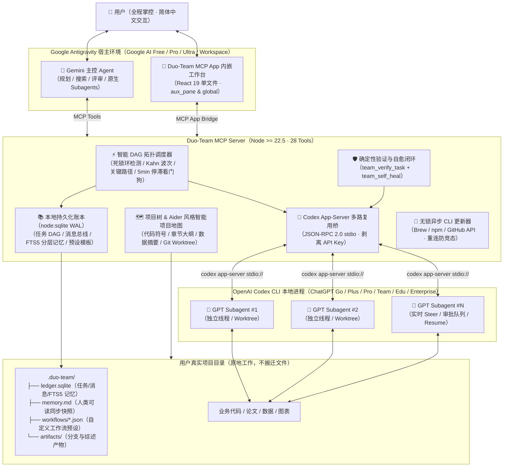

<p align="center">
  
</p>

<h1 align="center">Duo-Team</h1>

<p align="center">
  <strong>订阅制原生 Gemini（Antigravity）+ GPT（OpenAI Codex CLI）双强多 Agent 协作工作台</strong><br/>
  零额外 API 费用 · 官方协议直连 · 6 大协作模式 · 智能 DAG 调度与自愈 · SQLite FTS5 分层记忆 · 内嵌 MCP App 面板
</p>

<p align="center">
  <a href="./README.md">English</a> · <strong>简体中文</strong>
</p>

<p align="center">
  
  
  
  
  
  
</p>

---

## 目录

1. [为什么做 Duo-Team？设计哲学与订阅合规](#1-为什么做-duo-team设计哲学与订阅合规)
2. [技术路线与核心架构](#2-技术路线与核心架构)
3. [六大协作模式深度对比与实战指南](#3-六大协作模式深度对比与实战指南)
4. [快速开始与安装部署](#4-快速开始与安装部署)
5. [工作台五大面板与交互详解](#5-工作台五大面板与交互详解)
6. [典型场景实战（学术科研 / 软件工程 / 复杂多任务）](#6-典型场景实战学术科研--软件工程--复杂多任务)
7. [自定义工作流（Custom Workflow）JSON 规范](#7-自定义工作流custom-workflowjson-规范)
8. [完整 28 个 MCP 工具清单](#8-完整-28-个-mcp-工具清单)
9. [项目结构、开发测试与安全隐私](#9-项目结构开发测试与安全隐私)
10. [常见问题（FAQ）与演进路线图](#10-常见问题faq与演进路线图)

---

## 1. 为什么做 Duo-Team？设计哲学与订阅合规

如果你同时拥有 **Google AI（Free / Pro / Ultra / Workspace）** 和 **ChatGPT（Go / Plus / Pro / Team / Edu / Enterprise）** 任意档位订阅，过去想让 Gemini 和 GPT 真正协同工作，通常会遇到三个痛点：

1. **高昂的重复付费**：市面上绝大多数多 Agent 框架（CrewAI / AutoGen / LangGraph 等）要求填写按量计费的 OpenAI / Gemini API Key，长上下文研究或大型代码库跑一轮动辄几十美元，已经付过的个人月费订阅完全用不上。
2. **第三方逆向/中转封号风险**：通过抓取浏览器 Cookie、反代 OAuth Token 或写外部定时脚本自动唤醒 Antigravity，既极不稳定，也明确违反平台服务条款。
3. **“单模型角色扮演”的伪多智能体**：让同一个模型既当作者又当审稿人，本质上是同源分布自证，很难发现真正的逻辑漏洞、代码边界 Bug 或计量经济学设定错误。

### 核心解法：非对称合规（Asymmetric Compliance）

Duo-Team 的架构严格遵循两家平台官方明确允许的交互边界：

- **Antigravity（Google AI Free / Pro / Ultra / Workspace）作为交互式主控宿主**：始终由用户在 Antigravity 内亲自发起对话，充分发挥 Gemini 原生的文件系统、终端、联网搜索、`invoke_subagent`、`run_workflow` 与内嵌 MCP App 能力，**绝不写外部守护脚本绕过或抓取 Antigravity 凭证**。
- **Codex CLI（ChatGPT Go / Plus / Pro / Team / Edu / Enterprise）作为官方协议执行集群**：通过 OpenAI 官方支持的 `codex app-server --listen stdio://` JSON-RPC 2.0 持久化子进程接入，启动时**主动剥离 `OPENAI_API_KEY` 与 `CODEX_API_KEY` 环境变量**，自动识别账户订阅档位与主/次双周期配额窗口（如 Plus 的 5 小时窗口 + 7 天周限额），实现 **$0 额外 API 费用** 的真实跨模型多开协作。

### 全订阅档位智能适配矩阵（Google × ChatGPT）

Duo-Team 会自动读取 Codex CLI 返回的真实账户档位（`plus` / `pro` / `team` / `edu` / `enterprise` / `go` / `free`）并结合你在工作台设定的 Google 订阅档位（`Free` / `AI Pro` / `AI Ultra` / `Workspace`），一键调优并发数、推理强度天花板（自动钳位到当前模型支持的真实档位）与低配额保护阈值：

| 双平台订阅组合 | 推荐 Codex 并发 | Codex 推理上限 | 低配额预警线 | 智能协作策略 |
| :--- | :---: | :---: | :---: | :--- |
| **Google AI Ultra × ChatGPT Pro / Enterprise** | `4 ~ 6` | `max` | `15%` | **双旗舰满血编队**：双端多路并发，全速运行自主团队、双盲研究与多轮深度辩论 |
| **Google AI Ultra × ChatGPT Plus** | `2` | `high` | `25%` | **Gemini 主力 + GPT 精准打击**：70% 探索/综述/并行验证交给 Gemini Ultra，Codex Plus 聚焦核心编码与关键审稿，保护 5 小时窗口 |
| **Google AI Pro × ChatGPT Pro** | `4` | `max` | `15%` | **GPT 重载执行 + Gemini 统筹**：重度编码、计量脚本与自愈返工充分交给 Codex Pro，Gemini 专注规划、联网检索与验收 |
| **Google AI Pro × ChatGPT Plus** | `2` | `high` | `25%` | **高性价比节流组合**：开启智能复杂度路由，轻量任务自动降档（`low/medium`），把高档推理留给关键路径 |
| **Google AI Pro × ChatGPT Team / Edu** | `3` | `xhigh` | `20%` | **科研与团队均衡档**：50/50 按比较优势分工，适合联合共创、课题组论文与自定义流水线 |
| **Google AI Free × ChatGPT Pro** | `4` | `max` | `15%` | **Codex 主力引擎**：Antigravity 做轻量级总控与拍板，将绝大部分分析与编码卸载到 Codex Pro |

| 对比维度 | Duo-Team（订阅原生插件） | API Key 多 Agent 框架 | 非官方反代/外部包装脚本 |
| :--- | :--- | :--- | :--- |
| **额外 API 费用** | **$0**（直接复用已有双订阅） | 按 Token 高额计费 | 表面免费但极易封号 |
| **账号与协议合规** | 100% 官方协议（Antigravity Plugin + `codex app-server`） | 官方 API | 违反 ToS / Cookie 易失效 |
| **跨模型真实性** | 真实双引擎（Gemini + GPT-6.x / Codex 系列） | 真实但配置繁琐 | 经常单模型串行拼接 |
| **实时操控感** | 原生侧边栏 MCP App 工作台 + 实时 `Steer` 插话 + 审批弹窗 | 命令行日志为主 | 缺乏统一状态与干预机制 |
| **上下文连续性** | SQLite WAL + FTS5 记忆 + 智能项目地图 + 原生线程 `Resume` | 需自行搭建向量库 | 刷新即丢上下文 |

---

## 2. 技术路线与核心架构

### 2.1 系统整体架构图



### 2.2 七大核心技术路线

1. **官方 `codex app-server` 多路复用协议桥（`server/src/codex/client.ts`）**
   - 常驻单一 `codex app-server --listen stdio://` 进程，通过 JSON-RPC 2.0 并发管理多个 GPT 线程（Subagents）。
   - 支持分页 `model/list` 自动拉取账号下全部真实可用模型与动态推理档位（如 `low / medium / high / xhigh / max / ultra`），实时读取 `account/read` 与 `account/rateLimits/read` 订阅余量。
   - 原生支持 **`turn/steer`（运行中插话纠偏）**、**`thread/resume`（跨会话断点续聊）**、**并发批量拉起（`codex_spawn_batch`）**、**全体广播（`codex_broadcast`）**、**沙箱审批队列（`approval`）** 与 Codex 原生子线程追踪。
   - 内置 `connGen` 连接代际锁与无锁异步 CLI 更新器（`server/src/codex/updater.ts`）：检测更新直连 `formulae.brew.sh` / npm / GitHub API（绕过 Homebrew `lockf` 锁冲突），升级在后台异步执行并实时回传日志，升级完成后自动重连再标记成功，彻底杜绝 MCP `-32001` 超时与断连。

2. **智能 DAG 拓扑调度器与自愈验证闭环（`server/src/scheduler/engine.ts`）**
   - **拓扑诊断**：基于 DFS 检测任务依赖死锁环（Cycle Detection），基于 Kahn 算法自动划分并行执行波次（`Wave 1 → Wave 2 → ...`）并计算项目关键路径（Critical Path）。
   - **守护机制**：内置 5 分钟线程停滞看门狗（Stall Watchdog）与低配额保护阀（配额紧张时自动提示收敛并发与推理档位）。
   - **角色与订阅档位自适应路由**：按任务角色（`planner / executor / reviewer`）、复杂度以及你的 Google × ChatGPT 订阅档位自动匹配并钳位推理深度，始终优先遵循用户手动锁定的 GPT 模型。
   - **确定性自愈闭环（`team_self_heal`）**：验收任务时自动执行 `verifyCommand`（单测 / 构建 / 脚本运行）并核对 `artifacts` 文件是否存在；一旦失败且 `reworkCount < maxReworks`，自动将完整报错日志打回**原 `codexThreadId`** 启动定向自愈返工；超过返工上限后自动置为 `awaiting_human`，防止死循环空耗额度。

3. **SQLite WAL + FTS5 分层共享记忆（`server/src/ledger/store.ts`）**
   - 基于 Node 22.5+ 原生内置 `node:sqlite`（`DatabaseSync`，**零第三方 C++ 原生编译依赖**），每个项目独立存储在 `<workspace>/.duo-team/ledger.sqlite`（WAL 模式防并发写锁）。
   - 记忆按 4 种结构化类型分层管理：`decision`（已确认决策）、`pitfall`（避坑防循环）、`fact`（关键事实与口径）、`convention`（项目规范），支持**置顶（Pinned）**与 **FTS5 + 子串混合检索**（中英文均友好）。
   - 每次增删或置顶记忆后，自动双向同步到人类可读的 `.duo-team/memory.md`；调用 `team_auto_dispatch` 发车时，系统会自动把置顶记忆、焦点文件与项目地图注入给 Codex，确保两家模型始终在同一份 `Single Source of Truth` 上工作。

4. **Aider 风格智能项目地图与交互式文件树（`server/src/ledger/workspace.ts`）**
   - 自动扫描工作区并生成紧凑的 **Smart Project Map**：提取代码符号（TypeScript/JavaScript/Python/Go/Rust/R/Stata 类与函数签名）、学术文档结构（Markdown/LaTeX 章节标题）以及数据文件摘要（CSV/TSV/Parquet/DTA/XLSX 维度与列名）。
   - 支持用户在工作台文件树中一键 **Pin 焦点文件（Pinned Files）**，被置顶的核心文件将自动成为 Gemini 与所有 Codex Subagent 的高优先级上下文。
   - 同时实时探测 Git 变更状态、活跃 Worktree 与本地科研/开发工具链（`python3`、`Rscript`、`stata`、`latex`、`pandoc`、`libreoffice`、`git`、`node`、`uv`）。

5. **文件所有权防冲突与 Git Worktree 并发隔离**
   - 坚持“多读单写”铁律：多个 Agent 可并发读取冻结的数据或代码，但同一文件同一时刻仅允许一个写入负责人。
   - 在 Git 仓库中并发派发多个写代码任务时，`team_auto_dispatch` 或 `codex_spawn(..., createWorktree: true)` 会自动在独立 Git Worktree 中运行各路 Codex Subagent，彻底避免文件互相覆盖与脏工作区冲突。

6. **原生内嵌 MCP App 工作台（`ui/src/App.tsx` & `ui/src/styles.css`）**
   - 使用 React 19 + TypeScript + Vite (`vite-plugin-singlefile`) 打包为单一自包含资源 `ui://duo-team/workbench.html`，同时支持 Antigravity `aux_pane`（右侧伴随面板）与 `global`（独立全局面板）。
   - 配备非线性弹簧物理动效（Spring Glider 导航滑块 + `ResizeObserver` 精准对齐、双引擎脉冲连接桥、聚光灯模型卡片、环形配额表盘、DAG 波次流视图）与 3 秒静默自动同步。

7. **中文优先与跨平台零折腾启动（`bin/duo-team-server`）**
   - 团队规则、Codex `developerInstructions`、记忆快照、任务流与工作台界面默认**简体中文**（可通过工作台或配置切换英文）。
   - `bin/duo-team-server` 自动兼容 macOS / Linux，按序探测环境变量、`nvm`、`fnm`、`volta`、Homebrew 与系统路径中的 Node `>= 22.5`，彻底规避 GUI 插件宿主 `PATH` 丢失问题。

---

## 3. 六大协作模式深度对比与实战指南

Duo-Team 内置 **6 种经过端到端自动化测试验证的协作模式**，覆盖从“严谨规划交付”到“学术盲审对比”“红蓝深度辩论”“全自主多波次推进”以及“团队私有流水线”的全部高频场景。

### 3.1 六大模式全景对比矩阵

| 模式 ID | 中文名称 | 角色分工方式 | 并发形态 | 首轮隔离/盲审 | 核心 MCP 工具链 | 最适用场景 | 额度消耗 |
| :--- | :--- | :--- | :--- | :--- | :--- | :--- | :--- |
| `plan_execute` | **规划与执行**（支持角色互换） | **支持自由互换**：Gemini 规划→Codex 执行，或 Codex 架构→Gemini/Codex 执行 | 按 DAG 依赖分波次并发 | 规划阶段强制跨模型质疑门禁 | `team_task_upsert` → `codex_spawn(Plan Reviewer)` → `team_auto_dispatch` → `team_self_heal` | 需求明确、重工程质量与返工闭环的软件开发、重构、实证代码复现 | 中 |
| `co_create` | **联合共创** | **按比较优势混合分工**（Gemini 文献/框架/润色，Codex 计量/重代码/单测） | 双方按里程碑交替/并发推进 | 里程碑级交叉评审与质疑 | `team_memory_add` + `team_task_upsert(owner=gemini/codex)` + `team_message_post(challenge/review)` | 学术论文联合写作、商业/技术报告、前后端或算法与文档联合交付 | 中 |
| `parallel_research` | **双盲并行研究** | Gemini 与 Codex 各自独立完成完整分析分支 | **双路真并发**（`async=true` + Gemini Subagent） | **严格首轮双盲**（互不读取对方产物） | `codex_spawn(async)` + `invoke_subagent(independent-reviewer)` + `team_message_post(branch_a/branch_b)` | 高风险架构选型、文献综述查漏补缺、疑难 Bug 根因独立诊断、计量模型敏感性对比 | 中高 |
| `debate` | **结构化正反辩论** | 一方持正方（Pro），另一方持反方（Con），多轮交锋后按证据裁决 | 首轮双盲并发立论 + 多轮有状态交锋 | 首轮盲立论，二轮起互看论据反驳 | `codex_spawn(con)` + `codex_message(同一 threadId 保留上下文)` + `team_message_post(debate/rebuttal/verdict)` | 重大技术路线分歧、论文核心假说压力测试、审稿人尖锐质疑模拟演练 | 中 |
| `autonomous_team` | **自主团队交付** | 自动拆解多波次 DAG，批量拉起多路 GPT + Gemini 子 Agent 持续推进 | **多波次满并发**（受 `maxParallelCodex` 保护） | 每任务独立验证 + 跨模型复核 | `team_schedule_plan` → `team_auto_dispatch` / `codex_spawn_batch` → `codex_broadcast` → `team_self_heal` | 大型端到端项目、长时间自动迭代（强烈推荐配合 `/goal` 或 `run_workflow`） | 高 |
| `custom` | **自定义工作流** | 完全由 `.duo-team/workflows/*.json` 预设定义角色、模型路由、验证命令与返工上限 | 按模板 `stages` DAG 自动拓扑并发 | 可自定义任意 `reviewer` 与验证脚本 | `team_workflow_preset(list / save / apply)` → `team_schedule_plan` → `team_auto_dispatch` | 课题组固定实证流水线、团队标准 TDD Sprint、高频重复性交付 SOP | 按模板 |

---

### 3.2 六大模式运作机制与 Prompt 示例

#### 模式 1：规划与执行（`plan_execute` — 支持自由角色互换）
- **核心亮点**：不是单向“老板派活”，而是带**计划质疑门禁（Plan Challenge Gate）**与**角色自由互换（Role Swap）**的闭环模式。
  - **路线 A（Gemini 规划 → Codex 质疑 → Codex 执行 → Gemini 复核）**：Gemini 先写 DAG 计划与验收命令；拉起只读 Codex（`Plan Reviewer`）挑刺；修正后发车执行；最后运行 `team_self_heal` + Gemini 复核。
  - **路线 B（角色互换：Codex 架构规划 → Gemini 质疑 → 混合执行 → Codex 复核）**：特别适合硬核系统架构、底层算法或复杂计量识别设计——先请 `GPT-6.2-Sol`（`effort: xhigh`）出架构蓝图，Gemini 提出边界质疑后落地，再交回原 Codex 架构师线程终审。
- **典型 Prompt**：
  > 「用 Duo-Team 的**规划与执行模式（角色互换）**：先让 Codex 作为首席架构师只读审查当前仓库并给出重构 DAG 计划，由你（Gemini）对计划提出质疑并定稿，然后并行派发编码任务，完成后跑单测并交回 Codex 复核。」

#### 模式 2：联合共创（`co_create`）
- **核心亮点**：把 Gemini 和 GPT 各自最擅长的能力拧成一股绳。双方共享同一份 `.duo-team/memory.md`（通过 FTS5 记忆实时同步口径），任务看板中同时存在 `owner: "gemini"` 与 `owner: "codex"` 任务，每个里程碑相互发 `review` / `challenge`。
- **典型 Prompt**：
  > 「开启**联合共创模式**写这篇 DID 实证研究报告：你（Gemini）负责联网检索近三年文献、整理变量口径表并撰写引言与讨论；Codex 负责用 Python/Stata 清洗数据、跑基准回归、平行趋势检验与稳健性检验并输出 LaTeX 表格，每完成一个阶段互审并同步到共享记忆。」

#### 模式 3：双盲并行研究（`parallel_research`）
- **核心亮点**：彻底消除“锚定效应（Anchoring Bias）”。先将问题与输入文件冻结进 `memory.md`，随后**同时**拉起 Gemini 独立分支（写入 `.duo-team/artifacts/branch-gemini.md`）与 Codex 独立分支（写入 `.duo-team/artifacts/branch-codex.md`），首轮严禁互相查看对方草稿；收集完毕后在工作台以 `branch_a` / `branch_b` 并排呈现，最终合成「共识、分歧、缺失证据、待验证实验」报告（`synthesis.md`）。
- **典型 Prompt**：
  > 「对我们这个高并发缓存击穿故障启用**双盲并行研究模式**：不要先给 Codex 看你的判断，你和 Codex 各自独立排查代码库并分别写出根因分析与修复方案，最后并排对比两份报告的共识与分歧。」

#### 模式 4：结构化正反辩论（`debate`）
- **核心亮点**：把两个不同家族的大模型变成高水平“红蓝对抗智囊团”。
  1. **第 1 轮（双盲立论）**：Pro 与 Con 同时独立提交开篇陈词（`round=1`, `side="pro"/"con"`）。
  2. **第 2..N 轮（有状态交锋）**：将对方论点与证据路径喂给另一方，通过 `codex_message` 在**同一个 `threadId`** 上续答，让 Codex 保留完整推理上下文进行逐点反驳（`kind="rebuttal"`）。
  3. **证据裁决（`kind="verdict"`）**：按可验证代码/数据/测试证据排序输出裁决结论，未决争议明确标红交由人类拍板。
- **典型 Prompt**：
  > 「围绕『核心账本应该迁移到 PostgreSQL 还是继续使用 SQLite WAL + 读副本』启动**结构化辩论模式**：你（Gemini）持正方，Codex 持反方，先双盲立论，再交锋两轮，最后结合仓库实际并发与运维约束给出证据裁决。」

#### 模式 5：自主团队交付（`autonomous_team`）
- **核心亮点**：面向中大型目标的“自动驾驶引擎”。
  1. 调用 `team_schedule_plan` 自动拓扑拆分为 Wave 1 / Wave 2 / …，检查有无死锁环与关键路径。
  2. 调用 `team_auto_dispatch` 或 `codex_spawn_batch` 一键拉起多路 GPT Subagent（写代码自动开独立 Git Worktree），同时配合 Gemini 原生子 Agent 并行推进；需要全员改口径时一键 `codex_broadcast`。
  3. 每项任务完成后自动执行 `team_self_heal`（验证脚本 + 失败自动打回原线程返工）；如遇配额耗尽，优雅保留 `codexThreadId` 以便后续无缝 `thread/resume`；仅在重大歧义、高风险审批或超返工上限时挂起为 `awaiting_human`。
- **典型 Prompt**：
  > 「用**自主团队模式**完整实现本项目的新导出模块（后端 API、前端界面、单元测试与文档），开启 Git Worktree 并发隔离，自动跑测试与自愈返工，遇到需要我拍板的架构分歧再暂停问我。」

#### 模式 6：自定义工作流（`custom`）
- **核心亮点**：将你沉淀下来的最佳协作流程固化为项目级 JSON 预设（`.duo-team/workflows/<presetId>.json`），下次在任意项目**一键套用**即可自动切换模式、设定各角色专属模型/推理档位，并一次性把完整依赖 DAG 实例化到任务看板！
- **典型 Prompt**：
  > 「用 `team_workflow_preset` 帮我保存一套名为 `econ-paper` 的**自定义工作流**（含数据审计 → 基准回归 → 稳健性检验 → 审稿人挑刺四个阶段，并给 `reviewer` 绑定高推理档位），然后立即套用并执行第一波任务。」

---

## 4. 快速开始与安装部署

### 4.1 前置要求

1. **Antigravity**（已登录你的 **Google AI** 账号：Free / Pro / Ultra / Workspace 均可）。
2. **OpenAI Codex CLI**（已安装并通过 ChatGPT Go / Plus / Pro / Team / Edu / Enterprise 完成 OAuth 登录）：
   ```bash
   # 检查版本与登录态（建议保持最新版以获得最新 GPT 模型列表）
   codex --version
   codex login status
   ```
3. **Node.js `>= 22.5.0`**（使用内置 `node:sqlite`，无需额外安装数据库或原生编译工具链）：
   ```bash
   node -v
   ```

### 4.2 一键安装插件

```bash
git clone https://github.com/ZhangXY-sdu/duo-team.git
cd duo-team
./install.sh
```

`install.sh` 会自动完成：
1. 检查 Node 版本是否 `>= 22.5`；
2. 安装 npm 依赖并编译 MCP Server 与单文件 React 工作台 UI（`npm run build`）；
3. 校验 `bin/duo-team-server` 执行权限；
4. 将插件软链挂载至 `~/.gemini/config/plugins/duo-team`。

安装完成后，在 **Antigravity → Plugins Manager** 中点击刷新（或重启 Antigravity）即可看到 **Duo-Team** 插件就绪并暴露全部 28 个 MCP 工具。

### 4.3 三分钟上手体验

1. 在 Antigravity 中打开你的项目文件夹，向 Gemini 说：**「打开 Duo-Team 工作台」**（或由模型自动调用 `open_workbench`）。
2. 在工作台 **「模型与策略」** 标签页中：
   - 确认 Codex CLI 已连接、查看你账号下实时拉取的 GPT 模型列表与订阅余量环；
   - 选择你偏好的默认模型/推理档位与最大并行数（如 `4`），并确认语言为 `简体中文`。
3. 回到对话窗口，直接用自然语言指定任意一种协作模式（参见第 3.2 节的 Prompt 示例），即可实时在右侧工作台观战并随时插话接管！

---

## 5. 工作台五大面板与交互详解

Duo-Team 原生嵌入在 Antigravity 侧边栏（`aux_pane`）与全局视图（`global`）中，分为五大功能页签（支持弹簧物理平滑切换与 3 秒静默自动刷新）：

| 页签 | 核心功能与人工掌控点 |
| :--- | :--- |
| **1. 模型与策略** | • 双引擎连接状态脉冲桥 + 主/次双窗口订阅余量环形表盘 + **Google × ChatGPT 全订阅档位适配与一键优化**<br/>• 动态拉取账号下全部真实 GPT 模型与推理档位，支持全局默认锁 / 当前项目覆盖 / **角色级模型路由**（`planner / executor / reviewer`）<br/>• 协作语言（简体中文 / English）、最大并行 Subagent 上限（1~8）与无锁异步 Codex CLI 升级器<br/>• 底部内置 **「六大协作模式特色速览」** 交互卡片，一两句话看清各模式定位并支持一键切换 |
| **2. 智能调度看板** | • 顶部常驻当前模式特色提示条 + **可视化自定义工作流配置器**（免写 JSON，内置计量论文 / 全栈 TDD / 深度调研 3 套范本、支持点选前置依赖芯片、一键保存并套用）<br/>• 可视化呈现 DAG **拓扑波次（Wave 1 → Wave 2…）**、关键路径标识、死锁环告警与停滞看门狗提示<br/>• 支持一键波次自动发车（`auto_dispatch`）、一键自愈验证（`self_heal`）与 `awaiting_human` 人工拍板按钮 |
| **3. GPT 并发编队** | • 集中掌控所有活跃与历史 Codex 线程（含 Codex 原生派生子线程）<br/>• **并发编队发射器**：一次配置多个角色、沙箱权限与是否开启 Git Worktree 并批量拉起<br/>• **实时 Steer 插话**：GPT 正在思考或写代码时，直接发消息纠偏而不丢失已有推理进度<br/>• **全体广播（Broadcast）**、**一键中止 / 全部中止**、**内联沙箱审批（Approve / Decline）**，以及**历史线程断点续聊（Resume）** |
| **4. 协作与辩论流** | • 按时间线完整记录 Gemini 与 Codex 的每一条 `plan / challenge / review / debate / rebuttal / verdict`<br/>• 在 `parallel_research` 与 `debate` 模式下自动高亮呈现 `branch_a / branch_b` 与 `pro / con` 双栏对照 |
| **5. 项目树与记忆** | • **交互式可展开项目文件树**：点击图钉即可把核心文件设为 **Pinned Focus Files**（自动注入后续任务上下文）<br/>• 实时展示 **Aider 风格智能项目地图**、Git 变更与 Worktree 列表、本地科研/开发工具链探针徽章<br/>• **FTS5 分层共享记忆库**：按分类（决策/避坑/事实/规范）筛选、全文检索、新增、置顶与删除，实时同步 `.duo-team/memory.md` |

---

## 6. 典型场景实战（学术科研 / 软件工程 / 复杂多任务）

Duo-Team 内置了 3 个领域 Skill（`duo-orchestrate`、`duo-research`、`duo-dev`）与 1 个独立评审子 Agent（`independent-reviewer`），Antigravity 会按任务语境自动激活：

### 6.1 学术科研与计量经济学（`duo-research`）
- **覆盖工具链**：Python（pandas/statsmodels/linearmodels/pyfixest）、R（fixest/tidyverse）、Stata、LaTeX、Word（`.docx`）、PDF、PPT（`.pptx`）、Excel（`.xlsx`）。
- **推荐组合**：
  1. 先把数据字典、核心文献或论文提纲在工作台设为 **Pinned Files**；
  2. 用 `parallel_research` 让 Gemini 与 Codex 分别独立设计识别策略、工具变量与稳健性检验方案；
  3. 用 `co_create` 或 `custom` 预设推进代码清洗、实证回归、图表与 LaTeX 排版，每个结果必须经 `verifyCommand` 可复现运行检验；
  4. 投稿前用 `debate` 模式让 Codex 扮演顶刊挑剔审稿人（Referee #2）逐条攻击，Gemini 负责组织回复信（Response Letter）并验证补充回归。

### 6.2 软件工程与全栈开发（`duo-dev`）
- **推荐组合**：
  1. 用 `plan_execute`（可角色互换）先做架构设计与计划质疑；
  2. 用 `autonomous_team` 按 DAG 波次自动发车，并行写入代码时自动启用 `createWorktree: true` 实现 Git Worktree 物理隔离；
  3. 每个模块绑定 `verifyCommand`（如 `npm run typecheck && npm test`），通过 `team_self_heal` 自动跑测试并把报错打回原线程自愈修复；
  4. 合并前由另一模型（或 `independent-reviewer`）做独立跨模型 Code Review，防止同源盲区。

### 6.3 复杂通用任务与多开编队操控
- 需要多角度调研、多份文档并行撰写、或同时排查多个子系统时，可直接要求：
  > 「用 `codex_spawn_batch` 同时开 3 个 Codex Subagent 分别排查鉴权、数据库和前端性能，我会在工作台里随时用 Steer 给它们补充线索，发现共性问题时用 `codex_broadcast` 同步全员。」

---

## 7. 自定义工作流（Custom Workflow）JSON 规范

自定义工作流预设以标准 JSON 文件存放在 `<workspace>/.duo-team/workflows/<presetId>.json`，既可直接手写编辑，也可通过 `team_workflow_preset(action="save")` 生成，随后在工作台一键套用或由模型调用 `team_workflow_preset(action="apply")`。

### 示例：`.duo-team/workflows/econ-empirical-paper.json`

```json
{
  "id": "econ-empirical-paper",
  "name": "计量实证论文标准流水线",
  "description": "数据审计 → 基准回归与稳健性检验 → 顶刊审稿人红蓝挑刺 → 论文定稿",
  "maxReworks": 3,
  "roleModels": {
    "planner": { "model": "GPT-6.2-Sol", "effort": "high" },
    "executor": { "model": "GPT-6.2-Astra", "effort": "high" },
    "reviewer": { "model": "GPT-6.2-Sol", "effort": "xhigh" }
  },
  "stages": [
    {
      "id": "S1-AUDIT",
      "title": "原始面板数据质量审计与描述性统计",
      "description": "检查缺失值、异常值、样本区间与面板平衡性，输出 data_audit.md 与 Table 1。",
      "owner": "codex",
      "reviewer": "gemini",
      "dependsOn": [],
      "acceptanceCriteria": "输出可复现的统计脚本与无警告审计报告",
      "verifyCommand": "python3 scripts/01_audit.py",
      "artifacts": ["output/data_audit.md", "output/table1_summary.tex"]
    },
    {
      "id": "S2-DID",
      "title": "基准 TWFE / 交错 DID 回归与平行趋势检验",
      "description": "完成主回归、事件研究法图示及聚类标准误设定。",
      "owner": "codex",
      "reviewer": "gemini",
      "dependsOn": ["S1-AUDIT"],
      "acceptanceCriteria": "脚本零报错退出且生成主表与事件研究图",
      "verifyCommand": "python3 scripts/02_baseline_did.py",
      "artifacts": ["output/table2_baseline.tex", "output/fig1_event_study.pdf"]
    },
    {
      "id": "S3-ROBUST",
      "title": "稳健性与异质性检验（安慰剂 / 替代指标 / PSM-DID）",
      "description": "按 memory.md 约定的口径运行全部稳健性检验并汇总表格。",
      "owner": "codex",
      "reviewer": "gemini",
      "dependsOn": ["S2-DID"],
      "acceptanceCriteria": "所有稳健性脚本通过且结果方向一致",
      "verifyCommand": "python3 scripts/03_robustness.py",
      "artifacts": ["output/table3_robustness.tex"]
    },
    {
      "id": "S4-REFEREE",
      "title": "Gemini 撰写实证章节 + Codex 模拟 Referee #2 终审",
      "description": "撰写实证结果解读并对内生性与外部有效性提出批判性审查。",
      "owner": "gemini",
      "reviewer": "codex",
      "dependsOn": ["S3-ROBUST"],
      "acceptanceCriteria": "所有审稿质疑均有实证证据或局限性说明回应",
      "verifyCommand": null,
      "artifacts": ["manuscript/section4_results.tex", ".duo-team/artifacts/referee_review.md"]
    }
  ]
}
```

---

## 8. 完整 28 个 MCP 工具清单

<details>
<summary>点击展开查看全部 28 个 MCP 工具详细说明</summary>

### A. Codex App-Server 实时控制与编队（7 个）
| 工具名 | 作用说明 |
| :--- | :--- |
| `codex_status` | 检查本地 Codex CLI 连接态、真实可用模型/推理档位、用户模型锁、订阅配额与活跃线程数 |
| `codex_spawn` | 拉起单个真实 Codex 线程（支持指定 `role`、`sandbox`、`model`、`effort`、`async`、`createWorktree`） |
| `codex_spawn_batch` | 一次性并发拉起多路独立角色/模型/Worktree 的 GPT Subagent 编队 |
| `codex_broadcast` | 向所有活跃（或指定）Codex Subagent 广播全局指令（如口径变更、紧急纠偏） |
| `codex_wait` | 阻塞等待一个或多个异步 Codex 线程完成或进入 `waiting_approval` 状态 |
| `codex_message` | 向已有 `threadId` 发送续聊或实时插话（`steerIfRunning=true` 触发 `turn/steer`，否则 `thread/resume`） |
| `codex_control` | 中止单个线程（`interrupt`）、全部中止（`interrupt_all`）、处理沙箱审批（`approve`/`decline`）或重连桥接 |

### B. 项目账本、DAG 智能调度与工作流（10 个）
| 工具名 | 作用说明 |
| :--- | :--- |
| `team_project_init` | 在用户真实工作区原地初始化 `.duo-team/` 账本、记忆与工作流目录 |
| `team_board_read` | 读取项目全貌（配置、任务列表、消息流、共享记忆与活跃 Codex 运行记录） |
| `team_task_upsert` | 创建或更新任务节点（负责人、复核人、依赖 `dependsOn`、验收标准、验证命令、产物列表） |
| `team_message_post` | 在协作总线发布结构化消息（`plan / challenge / review / debate / rebuttal / verdict / note`） |
| `team_verify_task` | 运行确定性验证：检查 `artifacts` 存在性并执行 `verifyCommand` |
| `team_schedule_plan` | 智能 DAG 诊断：检测依赖死锁环、输出 Kahn 拓扑波次、关键路径、停滞看门狗与模型路由建议 |
| `team_auto_dispatch` | 一键按并行上限拉起当前波次全部就绪任务，自动注入置顶记忆、焦点文件与项目地图，Git 仓库自动开 Worktree |
| `team_self_heal` | 自动验收 + 失败定向自愈返工闭环（打回原 `codexThreadId` 修复，超限自动转 `awaiting_human`） |
| `team_workflow_preset` | 管理并套用 `.duo-team/workflows/*.json` 自定义工作流预设（`list` / `save` / `apply`） |
| `open_workbench` | 在 Antigravity 侧边栏打开 Duo-Team 原生内嵌工作台面板 |

### C. 分层记忆与项目智能感知（4 个）
| 工具名 | 作用说明 |
| :--- | :--- |
| `team_memory` | 直接读取或编辑人类可读的 `.duo-team/memory.md` |
| `team_memory_search` | 基于 SQLite FTS5 + 子串混合检索结构化共享记忆（支持按类型与置顶过滤） |
| `team_memory_add` | 新增/置顶/删除结构化记忆（`decision / pitfall / fact / convention`）并自动同步 `memory.md` |
| `team_project_map` | 生成 Aider 风格智能项目地图、交互式目录树、Git 变更/Worktree 状态与本地工具链探测 |

### D. 工作台前端专属交互工具（7 个，`visibility: ["app"]`）
| 工具名 | 作用说明 |
| :--- | :--- |
| `ui_dashboard_state` | 拉取工作台全量实时快照（项目、DAG 诊断、Codex 线程、模型、配额、记忆、预设与工具链） |
| `ui_update_model_config` | 更新全局/项目级 GPT 模型与推理档位锁、分角色模型路由、模式、语言及并发上限 |
| `ui_human_decision` | 提交人工拍板决策（批准、打回返工附意见、或取消 `awaiting_human` 任务） |
| `ui_check_codex_update` | 无锁查询远端最新 Codex CLI 版本（Homebrew JSON API / npm / GitHub API） |
| `ui_upgrade_codex_cli` | 异步后台升级本地 Codex CLI（`start` / `poll` 流式日志）并在升级后自动重连 |
| `ui_toggle_pin_file` | 在文件树中置顶/取消置顶焦点上下文文件（Pinned Files） |
| `ui_workspace_inspect` | 按需刷新工作区目录树、智能项目地图、Git 差异与本地工具链状态 |

</details>

---

## 9. 项目结构、开发测试与安全隐私

### 9.1 目录结构

```text
duo-team/
├── plugin.json                  # Antigravity 插件清单（入口、Skills、Rules、Agents、MCP）
├── mcp_config.json              # 跨平台 MCP Server 启动配置
├── bin/duo-team-server          # 智能 Node >= 22.5 探测器与服务入口
├── install.sh                   # 一键构建并软链安装到 Antigravity
├── rules/AGENTS.md              # 团队常驻规则（中文优先、单源记忆、真实跨模型、文件所有权）
├── skills/
│   ├── duo-orchestrate/SKILL.md # 6 大协作模式、DAG 智能调度与多开编队总控 Skill
│   ├── duo-research/SKILL.md    # 学术科研、计量经济与出版级文档协作 Skill
│   └── duo-dev/SKILL.md         # 架构评审、Git Worktree 并行编码与跨模型 CR Skill
├── agents/
│   └── independent-reviewer.md  # 无锚定偏见的 Gemini 独立审稿人/双盲分支/辩手子 Agent
├── server/src/
│   ├── index.ts                 # MCP Server 主入口（28 个工具 + 工作台 UI 资源）
│   ├── codex/client.ts          # 官方 codex app-server JSON-RPC 2.0 多路复用桥
│   ├── codex/updater.ts         # 无锁远端版本检测与后台异步 CLI 更新器
│   ├── ledger/store.ts          # node:sqlite WAL 账本、FTS5 记忆、自定义工作流预设引擎
│   ├── ledger/workspace.ts      # 交互式项目树、Aider 智能项目地图、Git 与本地工具链探测
│   ├── scheduler/engine.ts      # 环检测、Kahn 拓扑波次、关键路径、看门狗与自愈引擎
│   └── tests/                   # 自动化单元与 6 大协作模式端到端测试套件
└── ui/src/
    ├── App.tsx                  # React 19 MCP App 嵌入式工作台
    └── styles.css               # 非线性弹簧动效与高对比度双引擎设计系统
```

### 9.2 开发与端到端测试

```bash
# 类型检查（Server + UI）
npm run typecheck

# 完整构建（TypeScript Server + Vite 单文件工作台 HTML）
npm run build

# 运行全部 11 项自动化测试（账本、Mock Codex 协议桥、MCP E2E、全部 6 大协作模式 E2E + 多订阅档位适配）
npm test
```

### 9.3 安全与隐私保证

- **零密钥落盘**：不索取、不保存、不转发任何 OpenAI 或 Google OAuth Token / API Key；启动 Codex 时显式剥离 `OPENAI_API_KEY` 与 `CODEX_API_KEY`。
- **数据完全本地化**：所有项目账本（`ledger.sqlite`）、记忆（`memory.md`）与产物均保存在你本地项目目录 `.duo-team/` 下，无任何第三方遥测或云端中转服务器。
- **沙箱与人工审批防线**：默认优先以 `read-only` 或 `workspace-write` 运行 Codex；涉及越权操作或网络访问时，所有待审批命令都会拦截并送入工作台审批队列由你亲手放行。

---

## 10. 常见问题（FAQ）与演进路线图

### FAQ

<details>
<summary><strong>Q1: 为什么看不到最新的 GPT 模型（例如只显示 4 个旧模型）？</strong></summary>

旧版 `codex-cli` 返回的模型列表有限。打开 Duo-Team 工作台 **「模型与策略」** 页签，点击 **「检查更新」→「后台升级」**（或手动运行 `brew upgrade --cask codex` / `npm i -g @openai/codex@latest`），升级后工作台会自动重连并分页拉取账号下的全部最新模型与推理档位。
</details>

<details>
<summary><strong>Q2: 会不会不小心扣我的 OpenAI API 余额？</strong></summary>

不会。`CodexAppServerBridge` 在拉起 `codex app-server` 子进程时会主动删除 `OPENAI_API_KEY` 和 `CODEX_API_KEY` 环境变量，强制走本地 `codex login` 的 ChatGPT 订阅会话（Plus / Pro / Team / Edu / Enterprise / Go）。
</details>

<details>
<summary><strong>Q3: 多个 Codex Subagent 同时改代码会互相覆盖吗？</strong></summary>

在 Git 仓库下，`team_auto_dispatch` 与 `codex_spawn_batch` 支持为每个写入任务开启 `createWorktree: true`，自动在 `.duo-team/worktrees/` 中创建独立 Git Worktree 分支目录，互不干扰；非 Git 目录则遵循“多读单写”文件所有权规则。
</details>

<details>
<summary><strong>Q4: Antigravity 里提示插件无法启动，或报 Node 版本错误怎么办？</strong></summary>

确保系统（或 `nvm` / `fnm` / `volta` / Homebrew）中至少安装了一个 `Node.js >= 22.5.0`，并在仓库根目录执行过 `npm run build`（生成 `dist/` 目录），然后在 Antigravity Plugins Manager 中刷新插件即可。
</details>

### 演进路线图（Roadmap）

- [x] **v0.1**：官方 `codex app-server` JSON-RPC 桥 + SQLite WAL 项目账本 + Antigravity 基础插件
- [x] **v0.2**：内嵌 MCP App 实时工作台 + 无锁异步 Codex CLI 升级器 + 实时 Steer & 审批队列
- [x] **v0.3**：默认简体中文协作 + `codex_spawn_batch` / `codex_broadcast` 多开编队 + 角色级模型路由
- [x] **v0.4（当前版本）**：智能 DAG 拓扑调度器与自愈闭环 + SQLite FTS5 分层记忆 + Aider 风格智能项目地图与焦点文件置顶 + 自定义工作流预设引擎 + 全部 6 大模式端到端测试 + 非线性弹簧动效 UI
- [ ] **v0.5（规划中）**：可视化自定义工作流编辑器（拖拽编排 `stages`）、Git Worktree 一键 Diff 预览与自动合并向导、研究结果（LaTeX/Markdown/图表）内嵌预览卡片

---

## License

[MIT](./LICENSE) © Duo-Team Contributors
